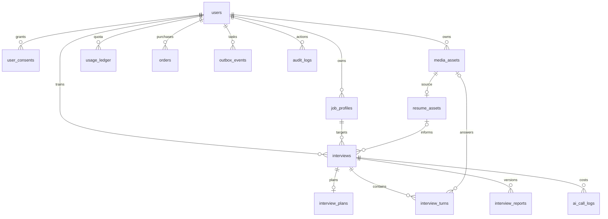

# 技术架构与实施清单

来源：需求说明书 V1.0、开发设计方案 V1.0、Python Framework Selection V1.0。数据库选型按用户后续要求由 PostgreSQL 切换为 MySQL 8.4。
用户已授权直接实施所有阶段。设计方案的细化状态枚举作为统一契约。

## 目录与依赖

```
app/api → app/modules/*/service → app/db/repository + app/providers
app/workers → app/modules（同一业务入口）
app/core（配置/鉴权/加密/限流/错误/状态机）
app/schemas（HTTP 与 AI 输出契约）
alembic/（版本化数据库） tests/ deploy/ docs/
```

API 默认包含持久化任务的后台执行器，也可独立运行 Celery Worker；MySQL 8.4 为事实源；Redis 为可选 Celery broker、限流、短锁和热缓存；S3/COS/MinIO 私有桶签名直传。
默认开发与部署连接 MySQL + Redis；SQLite 仅保留为可选测试后端。eager 模式在提交事务后处理持久化任务，用于本地开发和测试。
生产必须使用 MySQL，禁止 mock、local storage、eager、SQLite 和开发密钥。实际 LLM/ASR/TTS 可走兼容协议 Adapter 或自有 HTTP Gateway Adapter；契约见 provider-contract.md。

## ER



UUID 字符串主键，UTC DATETIME(6)，原生 JSON。表使用 InnoDB、utf8mb4/utf8mb4_0900_bin；加密文本使用 LONGTEXT。JD/简历/转写/报告加密；媒体不进库。
MySQL 连接使用 READ COMMITTED、UTC 时区、连接回收与存活检查；循环外键在新迁移 f4c8a1d2e903 中统一补齐。
interviews 版本列实现乐观锁；额度使用条件 UPDATE；幂等记录含请求哈希，冲突返回 409。
可靠任务用 outbox + lease + at-least-once，业务写与任务成功同事务；重试不重复创建轮次或扣额度。Celery 调度后使用 QUEUED 租约防止重复灌入 broker；过期租约可恢复。

## API

前缀 `/api/v1`，Bearer JWT，响应 `code/message/data/request_id`，分页 page/page_size。
创建面试/提交回答/结束/报告重生成/订单/退款使用必填 `Idempotency-Key`。

|域|接口|
|---|---|
|身份|POST auth/wechat-login、auth/dev-login、auth/logout；GET/PATCH users/me；GET/POST/DELETE users/me/consents；GET/DELETE users/me/data|
|岗位|POST/GET job-profiles；GET/PATCH/DELETE job-profiles/{id}|
|简历|POST resumes/upload-url；GET resumes、resumes/{id}；DELETE resumes/{id}|
|面试|POST/GET interviews；GET/DELETE interviews/{id}；POST interviews/{id}/start、pause、resume、finish、cancel、retry|
|轮次|GET interviews/{id}/turns；POST interviews/{id}/turns/{turn_id}/submit|
|媒体|POST media/upload-url；POST media/{id}/complete；GET/DELETE media/{id}|
|报告|GET interviews/{id}/report；POST interviews/{id}/report/regenerate|
|任务|GET tasks/{id}；POST tasks/{id}/retry|
|权益|GET billing/products、billing/entitlements、billing/usage；POST/GET billing/orders；GET billing/orders/{id}；POST billing/orders/{id}/refund|
|运营|GET admin/stats、admin/ai-calls、admin/audit-logs；POST feedback；PATCH admin/feedback/{id}|
|基础|GET health/live、health/ready；GET docs、openapi.json|

## 实施与验收

1. 工程底座：配置、鉴权、数据库/迁移、统一异常/追踪、Docker/CI。
2. 用户岗位：微信换码、授权、JD 结构化、简历安全上传/提取/关联。
3. 面试核心：计划/状态机/文字回答/有上限追问/澄清/终止/重试恢复。
4. 语音视频：私有直传/完整校验/ASR/TTS/分段轮次关联/回放/生命周期。
5. 报告成本：冻结快照、证据验证、多版本报告、历史筛选、调用与用量计量。
6. 商业边界：免费额度/原子预占/消费释放/套餐订单/开发支付/退款账本。
7. 数据治理：撤销授权/删除个人数据/媒体过期清理/审计/反馈/运营统计。
8. 验证：端到端成功/越权/幂等/失败重试/并发额度/文件攻击/迁移。

## 交付边界

微信 appid/secret、对象存储、AI 网关凭证需部署方注入。真实支付未指定商户与供应商，首版实现订单/退款业务及由 `MOCK_PAYMENT_ENABLED` 控制的模拟购买，所有环境一致；不冒充真实扣款，也不接受未经验签的真实渠道回调。
摄像头/麦克风操作属于客户端，后端记录授权并约束媒体用途；本项目交付后端。
OCR 和报告导出在原需求列为后续项；提供网关 OCR 边界，首版支持 PDF/DOCX 提取。
真机弱网、真实供应商质量/成本校准、20/50/100 会话压测属于部署后验收，不能由模拟测试替代。
